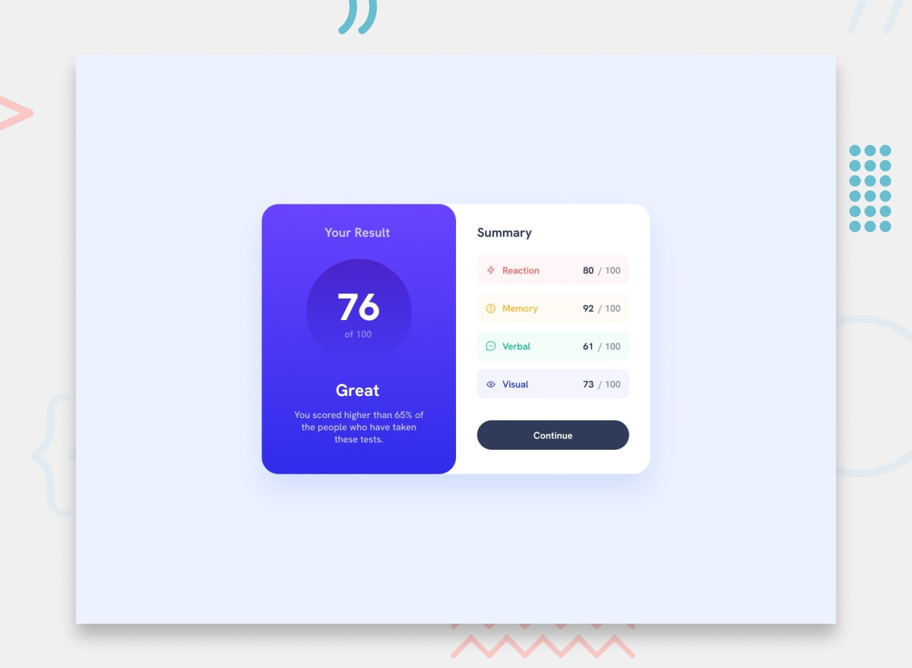

# Results Summary

A responsive results summary page that displays an overall score alongside category-by-category results.



## Features

- Responsive results summary layout
- Category scores and icons loaded from `data.json`
- Overall score calculated from the category results

## Built With

- HTML
- CSS
- Vanilla JavaScript

## Run Locally

Because the page loads `data.json` with `fetch`, open it through a local web server rather than directly as a file. For example, from the project directory run:

```sh
python -m http.server 8000
```

Then visit [http://localhost:8000](http://localhost:8000).

## Project Files

- `index.html` - page structure
- `style.css` - layout and visual styles
- `main.js` - loads result data and calculates the overall score
- `data.json` - category names, scores, and icon paths
- `assets/` - fonts and image assets
